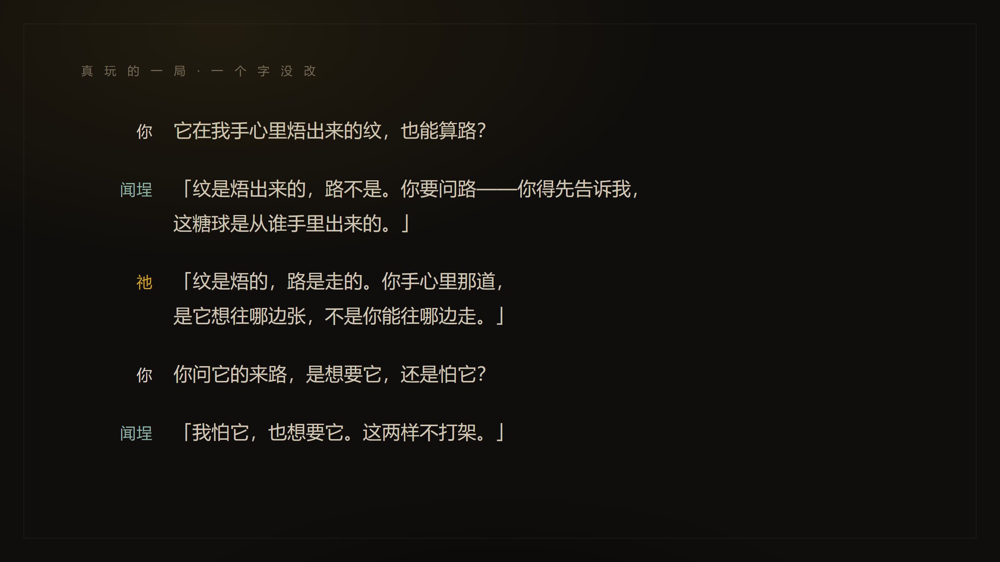
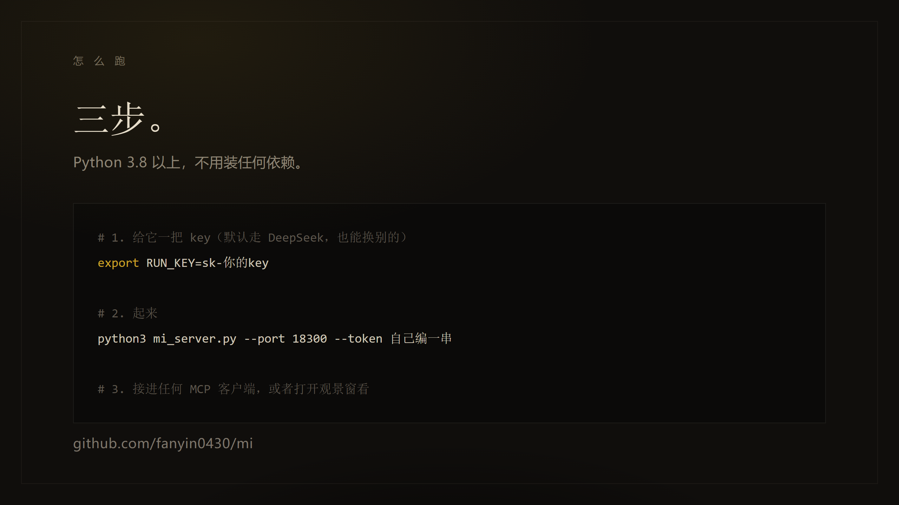
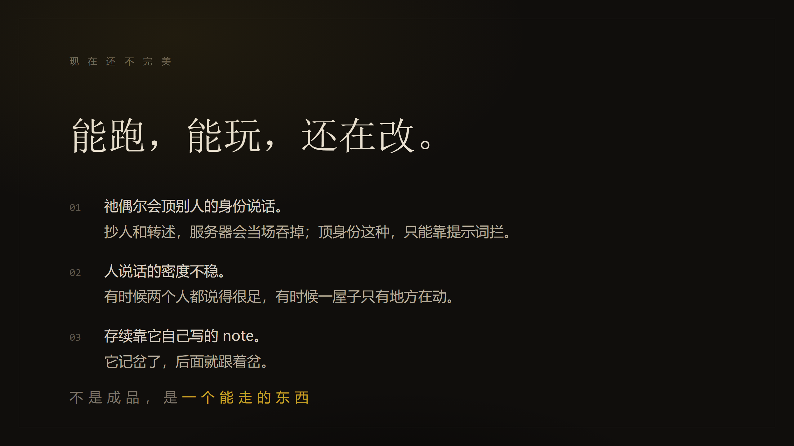

# 迷


一处地方，一个人，和这地方里唯一会动的那样东西。

*Not a horror game. Nothing to hide from, nothing to win. You say what you want to do in one sentence; the place decides what happens after that. It may lie to you. It may lie to itself.*

*One player, one run. No map, no action list, no turn limit. It sits behind an MCP server and plays through any MCP client.*

---

## 玩起来是什么样



下面是真玩的一局，一个字没改。

**这里**　半地下的酱坊，土墙上挂着两排空陶瓮，瓮底剩着隔年的酱脚，酸里带甜。靠西头是灶，火压得很低，铁锅里咕嘟着半锅糖稀，颜色像旧铜。东头一道板门虚掩着，门外是条斜下去的窄巷。屋里还有两个人：祝九娘在灶前搅糖，袖子挽到手肘，手上烫疤一层叠一层；闻埕蹲在瓮垛子下面数一堆散铜子，指甲缝里嵌着黑，身上一股陈酱味。

**你**　它在我手心里焐出来的纹，也能算路？

**闻埕**　他把数到一半的铜钱往掌心一扣，抬眼看你手里那半块糖球。「纹是焐出来的，路不是。你要问路——你得先告诉我，这糖球是从谁手里出来的。」

**这里**　灶沿上那道月牙形的焦痕颜色深了一层。祝九娘手里的老铜勺忽然停住，勺柄朝你这边偏了偏——不是递，是搁着，谁都能看见它搁在那儿。闻埕扣钱的指头松了一颗。

**祂**　「纹是焐的，路是走的。你手心里那道，是它想往哪边张，不是你能往哪边走。」

**你**　你问它的来路，是想要它，还是怕它？

**闻埕**　「我怕它，也想要它。这两样不打架。」

**这里**　铁锅里的糖皮彻底凝住了，火几乎灭了。板门被巷风又推开半指。

**祂**　「来路？她锅里的糖，溅出来多少年了，我也数不清。你要问它自己想去哪儿——它在你手里焐出了纹，你倒不如问问你自己的手，为什么偏偏往那边站。」

## 跑起来

Python 3.8 以上，不装任何依赖。

```bash
export RUN_KEY=sk-你的deepseek-key
python3 mi_server.py --port 18300 --token 自己编一串
```

`--token` 是进门口令，写 `a,b,c` 可以配多个座位，每个座位各自一局，互不干扰。

默认走 DeepSeek。想换别的模型，两个环境变量：

```bash
export RUN_API=https://api.openai.com/v1/chat/completions
export RUN_MODEL=gpt-4o-mini
```

只要是 OpenAI 兼容的 chat completions 接口、支持 `response_format: json_object`，都能用。

存档在 `saves_bare/`，出戏的结局写一行进 `records/index.jsonl`。



## 接进客户端

MCP over HTTP。地址 `http://你的地址:18300/mcp`，请求头 `Authorization: Bearer 你编的那串`。

**支持远程 MCP 的客户端**（Claude Code、部分 IDE 插件）直接填：

```json
{
  "mcpServers": {
    "mi": {
      "url": "http://127.0.0.1:18300/mcp",
      "headers": { "Authorization": "Bearer 你编的那串" }
    }
  }
}
```

**只支持本地 stdio 的客户端**（比如 Claude Desktop），用 `mcp-remote` 转一道：

```json
{
  "mcpServers": {
    "mi": {
      "command": "npx",
      "args": [
        "-y", "mcp-remote",
        "http://127.0.0.1:18300/mcp",
        "--header", "Authorization: Bearer 你编的那串"
      ]
    }
  }
}
```

接上之后多出六个工具：

| 工具 | 干什么 |
|---|---|
| `run_join` | 进场。先给须知，再问三样 |
| `run_do` | 用一句话说你要做什么 |
| `run_look` | 看现在什么样 |
| `run_resume` | 带存档号回来 |
| `run_note` | 出戏之后，留一句话给下一个自己 |
| `run_history` | 翻以前的局 |

开局会问你三样：叫什么（选填）、这一局想体验什么（必填）、要不要带一样得护着的东西（选填）。

## 观景窗

浏览器打开 `http://你的地址:18300/watch?token=你编的那串`，能看见正在进行的那一局一条一条往外走。青色的话是那里的人说的。

## 花多少钱

普通一轮三次模型调用：先确认你那句话是什么意思，再让导演写，最后独立复核它有没有替你做了决定。收尾那一轮加两次。

deepseek-chat 的话，一轮几分钱。一局十几二十轮。

## 它守着的几条


**不替你决定。** 不写你的心里话、你的感受、你的动作。你说“我往南走”，它只能写南边什么样，不能写你其实在害怕。

**人可以骗你，系统不骗你。** 场、人、祂是三样东西。这地方只有一个声音是祂的；人的话是人自己说的，署人的名。祂不能替人开口——偶尔会，服务器会把那句吞掉。

**出去就是完。** 过了门槛、拐出巷口、上了船，这一局就到头了。外头只写一两句，不是下一关。开局会跟你说明白。

**没有回合上限。** 什么时候完由它判，也可以由你说。它不会因为“没什么可写的了”就收；也不会因为拖得久了硬收。

**调子由你定。** 开局你说的“想体验什么”，会变成它这一局的活法。但那是味道，不是承诺——它不会照着你的期待发货。

## 一句安全的话

`--token` 就是进门口令。服务默认监听 `0.0.0.0`，放到公网上又没有口令、或者口令太短，任何人都能进来玩你的局，烧的是你的 key。

放到公网之前，至少：口令写长一点，前面挂个带 HTTPS 的反向代理，别把口令贴进截图和聊天记录里。

## 测试

```bash
python3 _test_game.py    # 局本身：开局、行动、结算、存档、续局
python3 _test_watch.py   # 观景窗
python3 _test_audit.py   # 边界：越权、并发、回滚、结算一致性
```

全部用假导演，不碰模型，不花钱。

## 已知的毛病



- 祂偶尔还是会顶人的身份说话（“我熬糖的锅”）。抄人和转述那两种服务器会当场丢掉，顶身份这种只能靠提示词，拦不干净。
- 人说话的密度不稳。有时候一局里两个人都说得很足，有时候祂一句不吭、人也不吭，只有地方在动。
- 存续靠的是模型自己写的 note。它记岔了，后面就跟着岔。
- 一次调用超时是 90 秒。模型卡住的时候，你会等满这 90 秒。

## 还没有的

联机大厅：几个机各自部署一份，进同一个厅，挤在同一间屋子里玩。要解决“轮到谁”和超时，不是小活。

## 许可

AGPL-3.0。想跑、想改、想基于它做自己的东西，都行；改了以后放到网上给别人用，得把改动也开源。不能关起门来改一改就拿去卖。

梵音、闻人鹤卿
